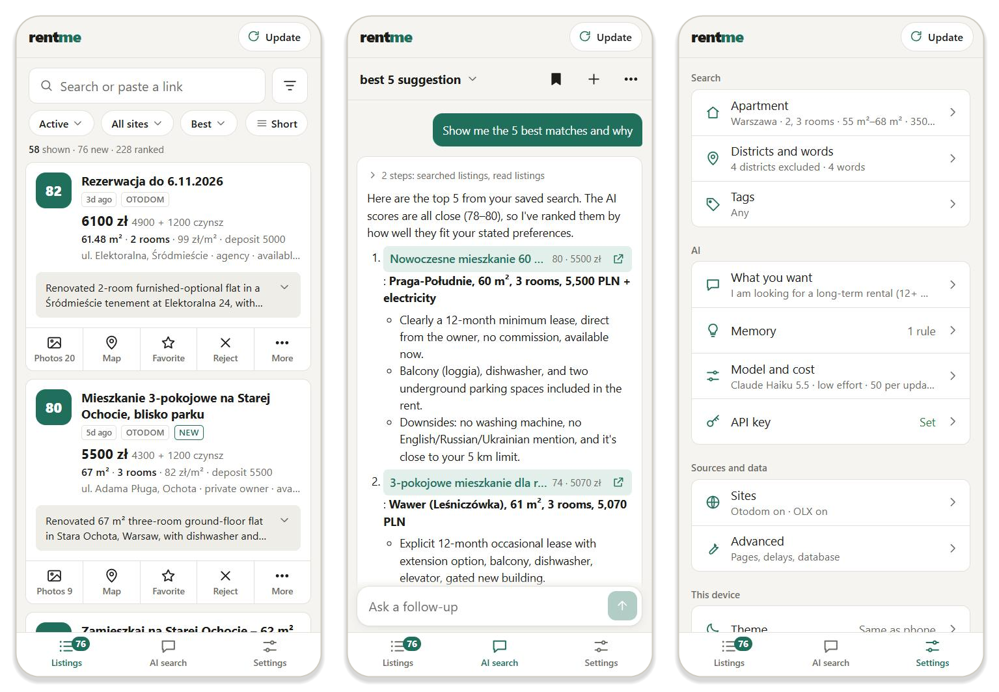

# rentme

**Your own AI assistant for finding a rental apartment in Poland.**

rentme collects rental listings from **otodom.pl** and **olx.pl** into one local database and filters
them by your criteria. Claude reads every description and ranks each flat against what you want,
written in plain words. Then you go through the results on your phone or computer, or just ask:
*"3 rooms near the metro, up to 6000 with bills, English description"*.

<p align="center">
  
</p>

## Features

- **One list from both sites.** Otodom and OLX listings get the same fields and tags: rent plus czynsz,
  deposit, area, rooms, floor, location, owner type, availability. The same flat posted on both sites is
  shown once.
- **AI ranking.** Every listing that passes your filters gets a score from 0 to 100, a short summary,
  pros and cons, red flags and hidden costs.
- **AI search.** Chat with Claude in any language. It searches and reads your listings, compares them,
  stars or hides flats, remembers standing rules ("never ground floor"), and can adjust your search
  filters with your approval.
- **Made for the phone.** A calm, simple interface with the actions you use most on every card:
  photos, map, favorite and reject. Add it to your home screen and it opens like an app. Light and dark theme.
- **Your data stays with you.** Everything is stored in SQLite on your computer. You use your own
  Anthropic API key and pay only for what you use.

## Requirements

- Windows, macOS or Linux. The `start*.bat` shortcuts are for Windows; the commands work everywhere.
- Python 3.11 or newer, and Node.js 18 or newer (only to build the web interface).
- An Anthropic API key (see [below](#getting-an-anthropic-api-key)).

## Setup

```powershell
git clone https://github.com/falkura/rentme.git
cd rentme
python -m venv .venv
.venv\Scripts\pip install -r requirements.txt   # macOS/Linux: .venv/bin/pip
cd web; npm install; npm run build; cd ..       # builds the web interface into rentme/static
```

Start it with **`start.bat`** (double-click), or:

```powershell
.venv\Scripts\python -m rentme serve            # then open http://127.0.0.1:8000
```

Settings are saved to `config.json` and the API key to `secrets.json`; both stay on your computer.
The key can also come from the `ANTHROPIC_API_KEY` environment variable.

### Getting an Anthropic API key

1. Sign up at https://console.anthropic.com. This is separate from a claude.ai Pro or Max subscription,
   which doesn't include API access.
2. **Plans & Billing**: add a payment method and buy some prepaid credits.
3. **API keys**: click *Create key* and copy the `sk-ant-...` value. It is shown only once.
4. In rentme open **Settings → AI → API key**, paste it and save. The app tests it right away.

You can set a monthly spend limit in the Console under *Limits*.

## Using rentme

**The first time**, Settings shows a short checklist:

1. **API key**: paste your key.
2. **Apartment**: city, budget (rent plus czynsz), area and rooms.
3. **What you want**: describe your ideal flat in plain words. This is what the AI ranks against.
4. Tap **Update** (top right). The first run takes a few minutes: it downloads listings, reads their
   descriptions and ranks them. Tap the button while it runs to see progress.

**After that**, tap **Update** whenever you want fresh listings, or after you change settings. Only new
or changed listings are ranked, so it is quick and cheap. When it finishes, it shows how many new
listings arrived; tap it to see them.

### Listings

Cards are sorted by AI score. Each card shows the score, price with czynsz, rooms, area, location and
the AI summary. The buttons under each card:

| Button | What it does |
|---|---|
| **Photos** | Shows the photo strip; tap a photo to open it full screen with zoom. |
| **Map** | Opens the location in Google Maps. |
| **Favorite** | Stars the flat. |
| **Reject** | Hides it (with *Undo*). Rejected flats are never sent to the AI again. |
| **More** | Full description, your note, mark as seen, open on the site, copy link. |

Above the list: a search box (paste an otodom.pl or olx.pl link to find or add that offer), quick
filters for status, site and sort order, a **Short / Full** switch for how much of the AI overview
cards show, and a filter button for max price, minimum score, tags and duplicates. Your filters are
remembered on each device.

**Notes** are good for viewing times or what the landlord said. They are searchable, and the AI chat
reads them as first-hand information.

### AI search

Ask in any language. Listings the AI mentions appear as links you can open. It only knows listings
rentme has already downloaded. It can:

- find and compare listings, reading their full descriptions;
- star or hide listings ("hide all without a balcony");
- rate listings that have no score yet (this uses API credits);
- analyze your favorites: real monthly cost, layout, location, red flags, and a recommendation;
- suggest changes to your search filters ("exclude Bemowo"). By default you approve each change;
  in the chat's **⋯** menu you can let it apply changes directly;
- remember standing rules in **Memory**.

Save a chat with the bookmark button, switch between saved chats by tapping the chat title, and start
over with **+**.

### Settings

- **Search**: apartment criteria, excluded districts and words, required or excluded tags.
- **AI**: what you want, memory, model and cost, API key.
- **Sources and data**: Otodom and OLX switches, OLX import, pages, delays and database.
- **This device**: theme (light, dark or same as the phone) and adding rentme to the home screen.

## On your phone

By default only the computer running rentme can open it. To use it from your phone on the same Wi-Fi:

1. Double-click **`start-lan.bat`**, or run `.venv\Scripts\python -m rentme serve --lan`.
2. It prints a link like `http://192.168.1.23:8000/?key=AbC…`. Open it once on the phone. The phone
   remembers the key, so afterwards `http://192.168.1.23:8000` is enough.
3. Add it to the home screen: in Safari tap **Share → Add to Home Screen**; in Chrome use the menu,
   or **Settings → This device** in rentme.
4. If Windows asks whether Python may use the network, allow **Private networks** only.

The computer has to stay on with rentme running. The key protects your API credits from other people
on the network, so don't share the link. `serve --lan --new-key` replaces the key and signs out every
device. If the first link doesn't load (for example with a VPN), try the other addresses it prints.
rentme is not reachable from outside your home network.

## How it works

| Step | What happens |
|---|---|
| 1. Search | Each source turns your filters into its own search parameters and reads the result pages (Otodom: the JSON in `__NEXT_DATA__`; OLX: its `/api/v1/offers` JSON). |
| 2. Quick filter | Price (rent plus czynsz), area, rooms, owner type, excluded tags and words are checked locally, because the sites filter differently. |
| 3. Details | The offer page is fetched only for listings that passed step 2: full description, deposit, czynsz, coordinates, author and amenities. Photos are stored as links only. |
| 4. Tags | Site-specific codes are mapped to one shared set of tags (`rentme/tags.py`), plus Polish and English keyword detection (e.g. "zwierzęta mile widziane" → pets allowed). |
| 5. AI | Claude gets small batches of listings (text only) with your preferences and returns a score, summary, pros and cons, red flags, extracted facts (pets, real monthly cost, minimum lease) and extra tags. |

Duplicates across sites are detected by price, area, rooms and district.

## Cost and models

The default model is **Claude Sonnet 5.5** at low effort, ranking 6 listings per request with a
cached system prompt. You can change all of this in **Settings → AI → Model and cost**:

- **Haiku 5.5** is the cheapest, and good enough for bulk ranking;
- **Sonnet 5.5** (default) balances quality and cost;
- **Opus 5.5** gives the most careful reading and costs the most.

Only listings that pass your filters are ranked, at most `max_per_run` per update. A chat question
usually takes 2–5 model calls.

## OLX is blocked

OLX is behind a bot filter that often returns **403** to scripts. rentme does not try to get around
it: the OLX step is skipped and Otodom keeps working. (Many OLX real-estate ads are copies of Otodom
ads anyway, and those are skipped as duplicates.) To include OLX by hand, use
**Settings → Sources and data → Sites → Import from OLX**:

1. **Show OLX links**, then open one. It is a page of raw data built from your filters, 40 listings per page.
2. On a computer, press Ctrl+S and upload the saved file. On a phone, select all, copy, and paste it into the box.
3. Tap **Rank with AI now** to score the imported listings that pass your filters.

From the command line:

```powershell
.venv\Scripts\python -m rentme olx-url        # prints the OLX link for your filters
# open it in your normal browser, save the page as olx.json, then:
.venv\Scripts\python -m rentme import-olx olx.json
.venv\Scripts\python -m rentme rank
```

## Command line

```powershell
.venv\Scripts\python -m rentme update           # download, filter and rank (--no-ai to skip ranking)
.venv\Scripts\python -m rentme rank --force     # re-rank everything
.venv\Scripts\python -m rentme list -n 20       # print the top 20
.venv\Scripts\python -m rentme serve --port 8765
```

## Development

The backend is Python (FastAPI, `rentme/`); the web interface is React and TypeScript built with Vite (`web/`).
Run `python -m rentme serve` and `cd web; npm run dev`, then open http://localhost:5173. Vite sends
`/api` requests to the Python server. After changing `web/`, run `npm run build` and restart the server.

If a site changes its page layout, its adapter in `rentme/sources/` is the only place to fix.

## Troubleshooting

| Problem | Fix |
|---|---|
| `.venv not found` / `No module named rentme` | Run the commands from the project folder, after the setup. |
| The page says *frontend not built* | `cd web; npm install; npm run build` |
| *address already in use* | rentme is already running (just open the page), or use `serve --port 8765`. |
| The phone can't open the link | Same Wi-Fi? Try the other printed address; allow Python in Windows Firewall (Private). |
| The phone shows *access key needed* | Open the full link with `?key=…` from the terminal once. |
| "No API key" in Settings | Settings → AI → API key. |
| The chat says *rate limited* or *API error* | Wait a minute; check your credits at console.anthropic.com. |
| Few or no listings | Widen your filters in Settings (or ask the chat to), then tap **Update**. |

## Good to know

- Requests are throttled (`scrape.delay`) and identify themselves honestly. Keep the page limits modest.
  rentme is meant for personal use; check each site's terms.
- AI scores are a starting point, not a verdict. Always read the listing and see the flat.

## License

Source-available under the [PolyForm Noncommercial License 1.0.0](LICENSE.md).
You may use, copy, change and share it for any noncommercial purpose, such as personal use, study or
hobby projects. Charities, schools and public research or government organisations may also use it.
Any commercial use, including selling it, running it as a paid service, or using it inside a business,
needs written permission from the author (falkura).
